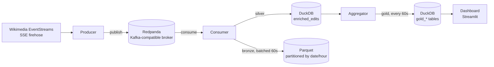

# 📊 Wikipedia Edit Stream Analytics

A real-time streaming pipeline that consumes Wikipedia's public global edit firehose, scores every edit for vandalism and suspicious activity with rule-based heuristics, and surfaces live analytics on a dashboard, running entirely on Docker Compose with no cloud account, no API keys, and no dataset to download.

## Overview

Unlike a typical batch ELT project, this pipeline has no dataset to seed. The moment the stack starts, the producer opens a live connection to Wikimedia's [EventStreams API](https://wikitech.wikimedia.org/wiki/Event_Platform/EventStreams) and begins ingesting every edit made across Wikipedia, in every language, every second, for as long as the stack runs.

Each edit is scored against six weighted heuristics (large content deletions, anonymous IP editors, empty comments on big changes, suspicious keywords, edit-warring patterns, and bot exclusion), stored through a bronze/silver/gold medallion architecture, and visualized on an auto-refreshing dashboard.

## Architecture



**Producer**: connects to `stream.wikimedia.org/v2/stream/recentchange`, parses each SSE event, validates it with Pydantic, and publishes it to a Redpanda topic. Reconnects automatically with exponential backoff (1s to 60s) on any disconnect.

**Redpanda**: single-node, Kafka-API-compatible broker. Chosen over vanilla Kafka for a much lighter resource footprint, which matters on a 16GB-RAM machine running four other services alongside it.

**Consumer**: reads raw events off the topic, computes a suspicion score per edit (see below), writes enriched records to a DuckDB `enriched_edits` table (silver layer), and batches raw events into hourly-partitioned Parquet files (bronze layer) every 60 seconds.

**Aggregator**: a scheduled job (every 60s) that pre-computes four gold tables so the dashboard never has to scan the full silver table, plus a retention job that deletes bronze Parquet files older than 3 days so disk usage doesn't grow unbounded.

**Dashboard**: a Streamlit app, auto-refreshing every 5 seconds, reading only from the gold tables: live edit volume, top edited pages, a suspicious-edit feed with links back to the actual Wikipedia page, and a bot-vs-human ratio chart.

## Suspicion Scoring

Every non-bot edit is scored 0 to 100 against these rules; a score of 50 or higher flags it as suspicious.

| Condition | Points |
|---|---|
| Large content removal (`length.new - length.old < -500`) | +30 |
| Anonymous editor (IP address) editing outside the Talk namespace | +15 |
| Empty edit comment on a large change (`\|Δlength\| > 1000`) | +10 |
| Comment matches a configured suspicious keyword | +25 |
| Same user edits the same page more than 3 times within 5 minutes | +20 |
| `bot == true` | Score locked to 0. Bots are tracked separately for the bot/human ratio, never flagged as suspicious |

Keywords live in `config/suspicious_keywords.yaml`, so the list can be tuned without touching code.

## Notable Engineering Challenges

This pipeline looked deceptively simple on paper but surfaced a handful of real, non-obvious bugs during development, the kind that only show up once you actually try to run something end to end against a live external stream:

- **Silent 403s from a header that never made it onto the request.** Building an `httpx.Request` by hand and sending it through `client.send()` doesn't inherit the headers set on `AsyncClient(headers=...)` the way convenience methods like `.get()` do, so the producer was quietly sending Wikimedia a request with no `User-Agent` at all.
- **A schema built for an envelope that doesn't exist.** The initial event schema assumed a CloudEvents-style wrapper (`type`/`topic`/`source`/`data`), but Wikimedia's actual recentchange stream is flat: every field except `meta` sits at the top level. Every single event failed validation until this was caught.
- **DuckDB's single-writer lock, discovered the hard way.** With the consumer, aggregator, and dashboard all touching the same DuckDB file, the aggregator's scheduled job was silently failing on every single cycle with `Conflicting lock is held`, because the consumer held its connection open continuously rather than just during writes. Fixed with a buffer-and-flush pattern plus short-lived connections everywhere: read-write for the aggregator (it rebuilds the gold tables), read-only for the dashboard.
- **Testing an infinite stream with a request method built for finite ones.** An early diagnosis concluded Wikimedia was blocking Docker containers outright, but the test that "proved" it used `httpx.get()` against an SSE endpoint that never closes its response, which will time out anywhere, blocked or not. Re-testing with `httpx.stream()` disproved the theory in seconds.

## Tech Stack

Python 3.11, httpx, confluent-kafka, Redpanda, DuckDB, Pydantic v2, APScheduler, Streamlit, Plotly, pytest, Docker Compose

## Setup & Run

No dataset, no API key, and no cloud account are required. The only prerequisite is Docker.

```bash
# 1. Copy the environment template and adjust if needed
cp .env.example .env

# 2. Build and start the full stack
docker compose up --build

# 3. Open the dashboard
# http://localhost:8501
```

Give it two to three minutes after startup for edits to accumulate before the charts look meaningful. To stop everything:

```bash
docker compose down
```

### Running the tests

```bash
pip install -r consumer/requirements.txt -r producer/requirements.txt pytest
pytest tests/ -v
```

## Dashboard

- **Live KPIs**: edits per second (rolling 1-minute), total edits since start, active wikis, percent flagged suspicious
- **Edit volume**: line chart of the last minute's edit counts per wiki, recomputed every 60 seconds
- **Top pages**: the 10 most-edited pages in the last 15 minutes
- **Suspicious feed**: the 50 most recently flagged edits (of up to 200 kept in the gold table), with score, comment, and a direct link back to the page on Wikipedia
- **Bot vs. human**: edit counts per minute, split by bot flag

## Known Limitations

- **Single-node deployment.** This is a portfolio-scale build, not designed to horizontally scale.
- **DuckDB is single-writer.** Ad-hoc queries against the database file from outside the running services can occasionally hit a transient lock conflict; the application's own read and write paths already use retry-with-backoff and don't have this problem.
- **The suspicious-edit feed depends on the observation window.** Vandalism-scale edits don't happen every minute on Wikipedia; if you check right after startup, `gold_suspicious_feed` may briefly be empty. The scoring logic is verified independently by the unit test suite regardless.
- **Rule-based scoring only.** No ML-based classifier; this was a deliberate scope decision to keep the detection logic transparent, deterministic, and CPU-only.
- **In-memory edit-warring detection.** The "same user, same page, 3x in 5 minutes" rule tracks state in the consumer's memory, so it resets if the consumer restarts.